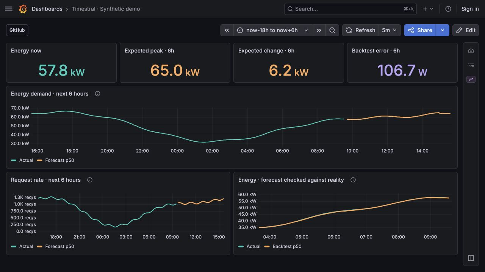

# Timestral for Grafana

Forecast your existing metrics with a self-hosted [Mistral Timestral](https://github.com/mistralai/timestral) model. Pick a Grafana datasource, write its usual query, and choose how far ahead to look.



## Try it

Requires Docker Compose and about 4 CPU cores / 8 GB RAM available to Docker.

```sh
git clone https://github.com/antoinerrr/grafana-timestral.git
cd grafana-timestral
docker compose up --build -d --wait
```

Open [localhost:3000](http://localhost:3000). The dashboard includes synthetic energy demand, traffic, forecasts, and a historical accuracy check. The first start downloads the model; subsequent starts reuse its cache.

Save a copy of the demo dashboard to keep your edits when the provisioned example is updated.

This local demo has no login and binds only to localhost. Keep it local. The inference image targets Linux amd64; Apple Silicon uses Docker emulation.

Stop with `docker compose down`. Add `-v` to remove saved dashboards and cached weights.

## Use your own Grafana

Requires Grafana 13 or later. Tested with 13.0.2.

1. Build the plugin with Node 22 or later:
   ```sh
   (cd plugin && npm ci && npm run build)
   ```
2. Copy `plugin/dist/` into your Grafana plugins directory as `antoinerrr-timestral-datasource`. Set `GF_PLUGINS_ALLOW_LOADING_UNSIGNED_PLUGINS=antoinerrr-timestral-datasource` and restart Grafana.
3. Run the [inference container](service/README.md) on a network Grafana can reach.
4. Add a **Timestral** datasource. Set the service URL, optionally its API token, then **Save & test**.
5. In a panel, choose **Timestral**, select your source datasource, and enter its normal time-series query. Choose a forecast duration and run it.

Use a **Time series** panel and extend its time range into the future, for example `now-18h` to `now+6h`. The forecast starts at the earlier of now and the dashboard's range end. History is fetched separately, so the visible range does not limit training data.

**Forecast** shows observations and p10/p50/p90 predictions. **Backtest** predicts the last part of the history, then compares it with the actual values. **Summary** provides current/forecast values and error scores for stat or table panels. Advanced settings control history, sampling, holdout duration, units, and physical bounds.

## Settings that worked best

These are starting points from our infrastructure tests, not universal optimal settings.

| Setting | Start with | Why |
| --- | --- | --- |
| Model | **5M** | 28M reduced average absolute error by less than 1% on each of four tested signals, at roughly 2.3× the compute time. |
| History | **7 days** | Best selection result among the tested memory configurations. |
| Sample interval | **5 minutes** | Coarser 15-minute sampling did not improve the selected configuration. |
| Forecast | **6 hours** | Useful default for capacity trends. Try **2 hours** for a shorter operational view. |
| Backtest | **On**, same duration | Compare Timestral's MAE with **Naive MAE**, which repeats the last observation. Lower is better. |
| Bounds | Only known limits | Use 0–100 for percentages, or 0 for nonnegative measurements. Bounds clip predictions; they do not improve the model. |

The model comparison used 28 historical windows per signal, with seven days of input and six-hour forecasts. Memory tuning tested nine configurations, selecting on the first 14 windows and evaluating on the next 14. Shorter history and coarser sampling gave no reliable six-hour improvement. A two-hour forecast was easier to get right, but did not improve predictions at the same lead time.

Choose stable series with enough history. Forecast rates rather than raw counters. Avoid aggregates whose membership changes: a node joining or leaving can move a memory percentage without a predictable trend. Deployments, restarts, and sudden workload changes remain difficult. The p10–p90 band is a nominal 80% interval, not a guarantee; check several historical ranges before relying on it.

To try the larger model:

```sh
TIMESTRAL_MODEL=28M docker compose up -d --wait
```

## How it works

```text
Grafana datasource → numeric samples → Timestral container → forecast panels
```

The plugin uses the selected datasource's own query editor and permissions. Only timestamps, numeric values, bounds, and opaque series IDs reach the inference service. Metric names, labels, queries, and datasource credentials stay in Grafana. The service has no Prometheus, Mimir, or Grafana connection configuration.

Supports up to 16 independent numeric time series per query. Each needs a time field, at least 64 sample slots, 48 finite values, and 50% coverage. Logs, traces, streaming queries, public dashboards, and Grafana-managed alerting are not supported. Compatibility depends on the source returning standard Grafana time-series frames.

## Development

```sh
cd plugin
npm ci
npm run typecheck
npm test
```

Python test and API instructions are in [service/README.md](service/README.md). CI tests the plugin, service, and a real-model container request.

## License

The integration is [Apache-2.0](LICENSE). Model weights are downloaded separately under Mistral's **Modified MIT** terms, including a commercial-license requirement above the stated $20M monthly revenue threshold. See [third-party notices](THIRD_PARTY_NOTICES.md). This is an independent community project.
